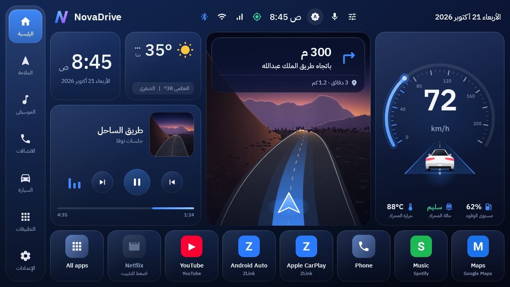
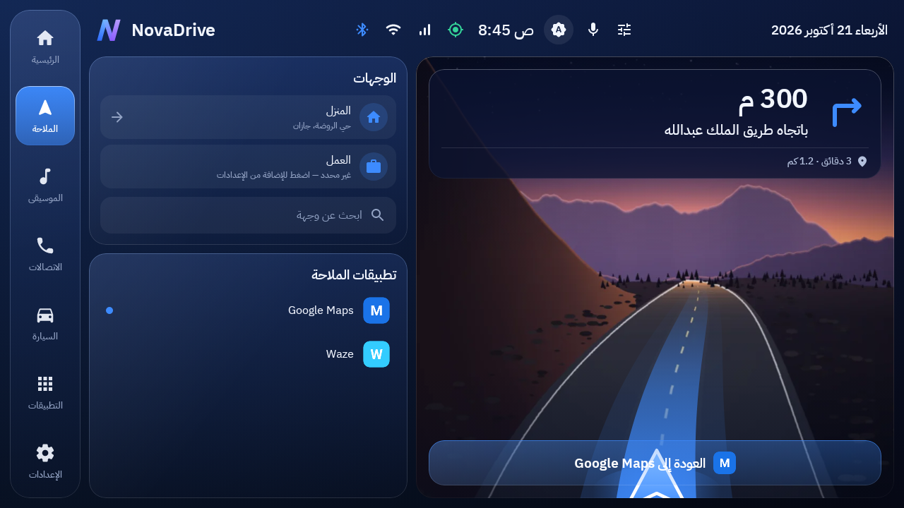
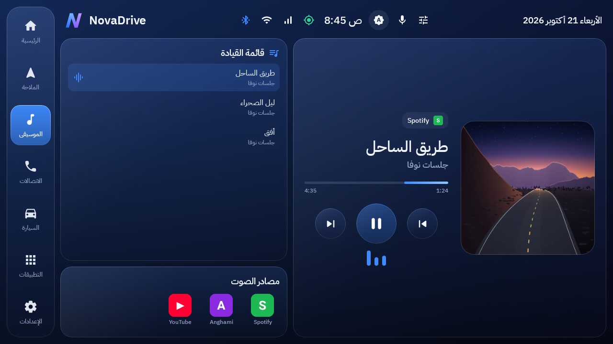
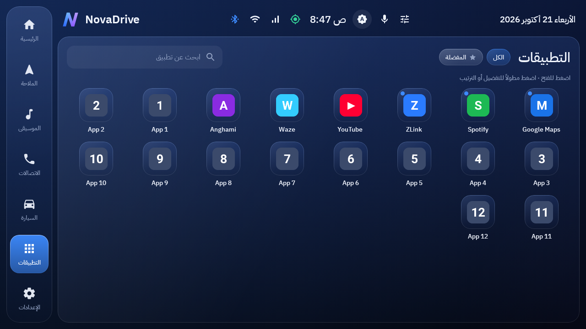
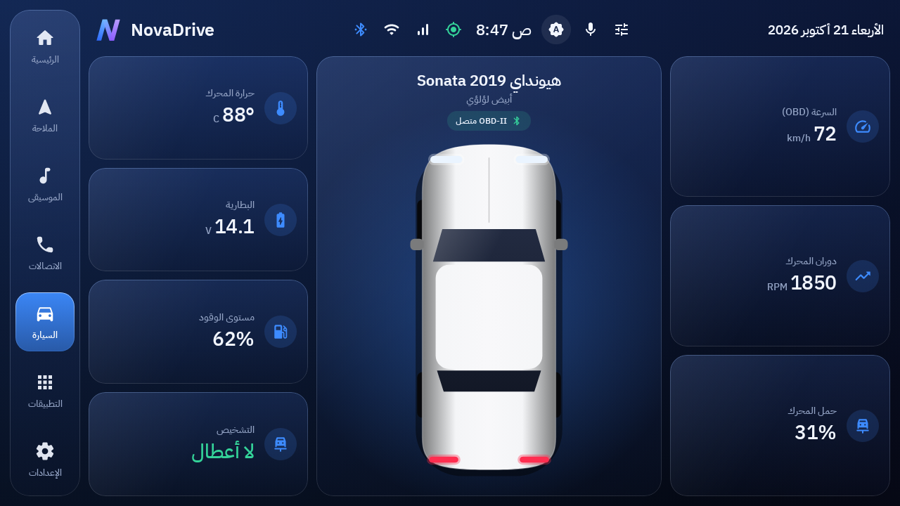
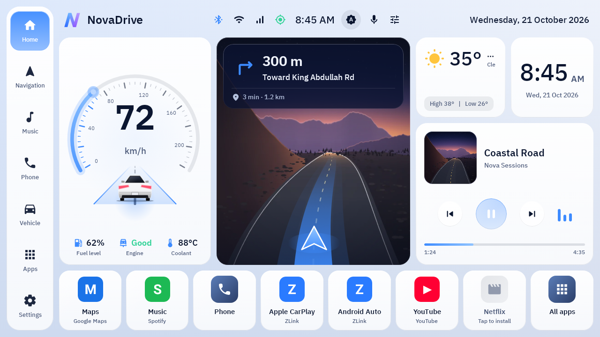
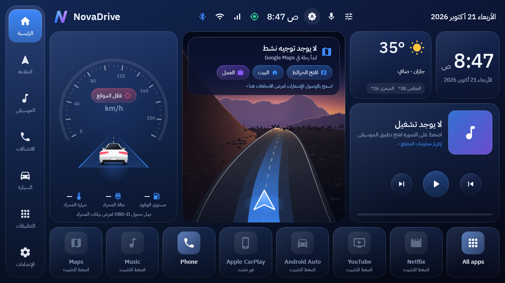

# NOVA DRIVE — Next‑Generation Smart Car Launcher

Native Android car launcher (Kotlin + Jetpack Compose) designed for the
**Tech Caravan Android 16 head unit** (Allwinner A133, 4 GB RAM, 1280×720).

**Developed by abu00salman**



| | |
|---|---|
|  |  |
|  |  |
|  |  |

Screenshots are rendered from the real Compose code at 1280×720 by CI
(`./gradlew :app:recordRoborazziDebug`); the values in them are test fixtures.

---

## العربية — طريقة البناء والتثبيت

### ١) بناء ملف APK تلقائياً على GitHub (بدون كمبيوتر)
1. أنشئ مستودعاً جديداً على GitHub باسم `novadrive` في حساب **abu00salman**.
2. ارفع محتويات هذا المجلد كما هي (بما فيها مجلد `.github`).
3. افتح تبويب **Actions** ← سيبدأ «Build NOVA DRIVE APK» تلقائياً (≈ ٦–١٠ دقائق).
4. عند انتهائه افتح التشغيل ← قسم **Artifacts** ← حمّل `NovaDrive-APK` (أو `NovaDrive-APK-debug` للنسخة التجريبية).
   لقطات الشاشة تُنشر تلقائياً في فرع `screenshots`.
5. لإصدار رسمي: أنشئ وسماً `v1.0.0` وسيظهر الـ APK في صفحة **Releases**.

### ٢) التثبيت على شاشة السيارة
1. انقل ملف الـ APK للشاشة (فلاشة USB أو حمّله من Chrome على الشاشة).
2. افتحه من مدير الملفات واسمح بـ «التثبيت من مصادر غير معروفة».
3. اضغط زر **Home** ← اختر **NOVA DRIVE** ← **دائماً**.
4. أول تشغيل: اسمح بالموقع (للسرعة والوضع الليلي والطقس).
5. من الإعدادات ← الأذونات: فعّل «الوصول لمعلومات الوسائط» (يُظهر المقطع الحالي **واتجاهات خرائط Google** في اللوحة) و«تعديل إعدادات النظام».
6. من الإعدادات ← **سيارتي**: اختر الشركة والموديل واللون (الافتراضي هيونداي سوناتا 2019 أبيض).

### خط ثمانية (اختياري)
ضع ملفات Thmanyah Sans بصيغة `.ttf` في `app/src/main/assets/fonts/` (يحتوي الاسم على `Thmanyah` ووزن مثل `Regular`/`Medium`/`Bold`)
وسيستخدمها التطبيق تلقائياً بدلاً من IBM Plex Sans Arabic المضمّن.

### ٣) الرجوع للواجهة الأصلية
الإعدادات ← **المشغّل** ← «اختر تطبيق الشاشة الرئيسية الافتراضي» أو افتح المشغّل الأصلي مباشرة.
أو من إعدادات أندرويد: التطبيقات ← التطبيقات الافتراضية ← تطبيق الشاشة الرئيسية.
لا يتم تعديل أي شيء في النظام — حذف التطبيق يعيد كل شيء كما كان.

---

## English — Build & install

### Build (GitHub Actions)
Push this folder to a GitHub repo → **Actions** builds `assembleRelease` →
download the **NovaDrive-APK** artifact. Tag `v*` to attach the APK to a Release.

### Build (Android Studio)
Open the folder (Ladybug 2024.2+ / JDK 17) → *Build › Build APK(s)*, or
`./gradlew :app:assembleDebug :app:assembleRelease` → `app/build/outputs/apk/`.

### Screenshots
`./gradlew :app:recordRoborazziDebug` renders every screen (Robolectric native graphics)
to `app/build/screenshots/`. CI publishes them to the `screenshots` branch on each push.

### Stable signing (recommended)
Without a keystore each CI run is signed with a fresh debug key, so an update
requires uninstalling first. To keep updates seamless, create a key once:

```bash
keytool -genkeypair -v -keystore nova.jks -alias nova -keyalg RSA -keysize 2048 -validity 10000
base64 -w0 nova.jks   # copy output
```
Add repo secrets: `NOVA_KEYSTORE_BASE64`, `NOVA_KEYSTORE_PASSWORD`, `NOVA_KEY_ALIAS` (=nova), `NOVA_KEY_PASSWORD`.

---

## What's real (no fake data)

| Feature | Android API | Notes |
|---|---|---|
| Speed | `LocationManager` GPS `Location.speed` | distance/time fallback |
| Turn-by-turn card | Navigation app's ongoing notification (Maps, Waze…) | needs notification access; tap returns to the app |
| Status bar | `BluetoothAdapter`, `ConnectivityManager`, GPS provider | tap opens the matching system panel |
| City + high/low | Android `Geocoder` + Open‑Meteo daily | city only if the unit has a geocoder |
| Music queue | `MediaController.queue` | only when the playing app publishes one |
| Dock | Real installed apps by package | missing apps offer the store or say "not installed" |
| Auto day/night | Offline solar‑altitude calculation | uses last GPS position |
| Weather | Open‑Meteo (no key) | cached, 30‑min refresh, offline‑first |
| Media | `MediaSessionManager` + media keys | keys work without permission (BT Music) |
| CarPlay | Launches ZLink/DiPlay; USB vendor 0x05AC detection | wireless CarPlay can't be observed |
| Split screen | `FLAG_ACTIVITY_LAUNCH_ADJACENT` | depends on unit's multi‑window |
| Volume / brightness | `AudioManager` / `Settings.System` | brightness falls back to window‑only |
| Vehicle data | ELM327 Bluetooth, SAE J1979 Mode 01 (0C, 0D, 05, 2F, 04, 01) + ATRV | **read‑only**, opt‑in; unsupported PIDs show "Not reported" |
| Voice | `RecognizerIntent` + AR/EN command parser | needs a recognizer (Google app) |
| Profiles | Per‑profile theme, language, favorites, shortcuts | |
| Crash recovery | Crash counter → Safe Mode + restore stock launcher | |

## Architecture
```
core/   Settings (per-profile), CarCatalog, CrashGuard, SunCalc
data/   Apps, Location, Weather (+city), Media (+queue), Status (BT/Wi-Fi), CarPlay,
        SystemControls, OBD, Voice, NotificationListener (+navigation guidance)
ui/     theme · components (Glass, DesignViewport) · shell (Rail, TopBar)
        home (Dashboard, Speedometer, scenic + nav card, media, dock, car renderers)
        nav · music · apps · vehicle · quick · settings
```
The UI is laid out on a fixed 1280×720 design grid and scaled to the real display
(`DesignViewport`), so 1024×600 and 1280×720 units at any density get the same composition.
The physical arrangement stays driver-side (rail on the left) in both languages; text inside
each panel follows Arabic RTL or English LTR.

Performance choices for the A133/Mali‑G31: no real‑time blur (layered gradients instead),
static scenic artwork (`res/drawable-nodpi/scenic_road.webp`, 18 KB, generated by
`tools/scenic_road.py`), speedometer lane animation only while moving, minute-tick clocks,
112 px icon cache, lazy subsystems, R8 minify + resource shrinking.

## Needs on-device testing
These depend on the head unit and can't be verified in CI: real GPS speed, Bluetooth/Wi‑Fi
state, ZLink/DiPlay launching and wired-iPhone detection, Android Auto through ZLink,
Google Maps guidance notifications, media-session artwork/queues, OBD-II with an ELM327
adapter (which PIDs the Sonata reports), Geocoder city names, split-screen support,
system brightness, and the speech recognizer.

## Safety
NOVA never touches vehicle controls, CAN bus or the head unit's MCU. OBD support only
reads standard diagnostic values. Settings, search and editing lock above 8 km/h.
